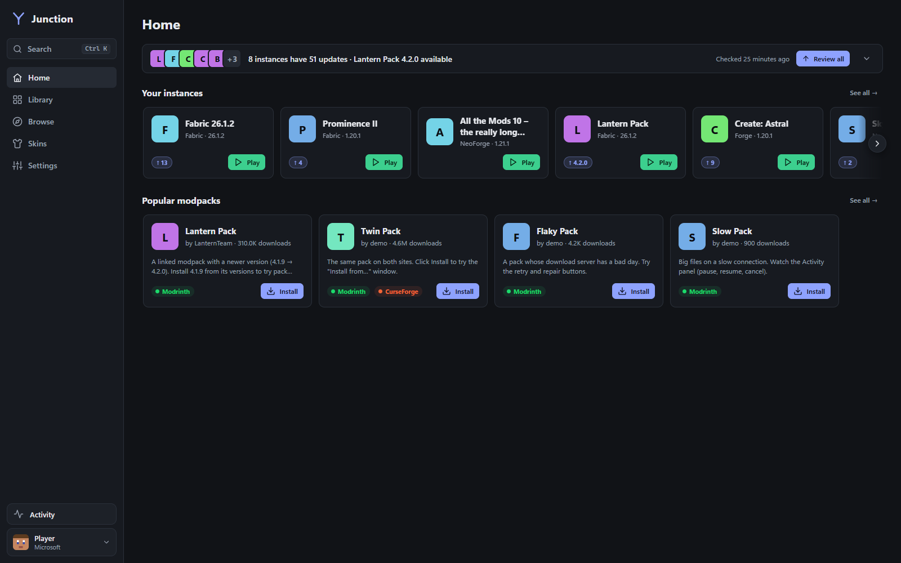
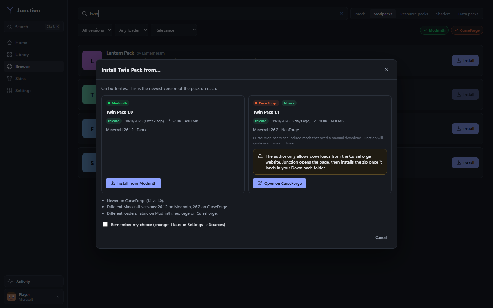
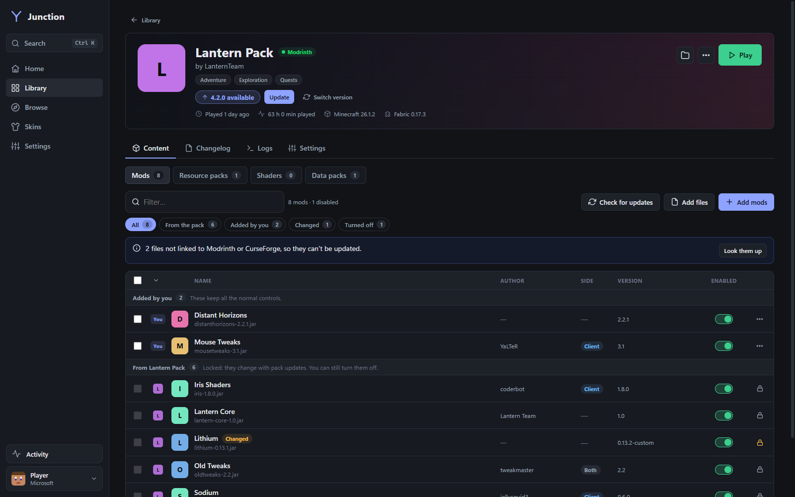
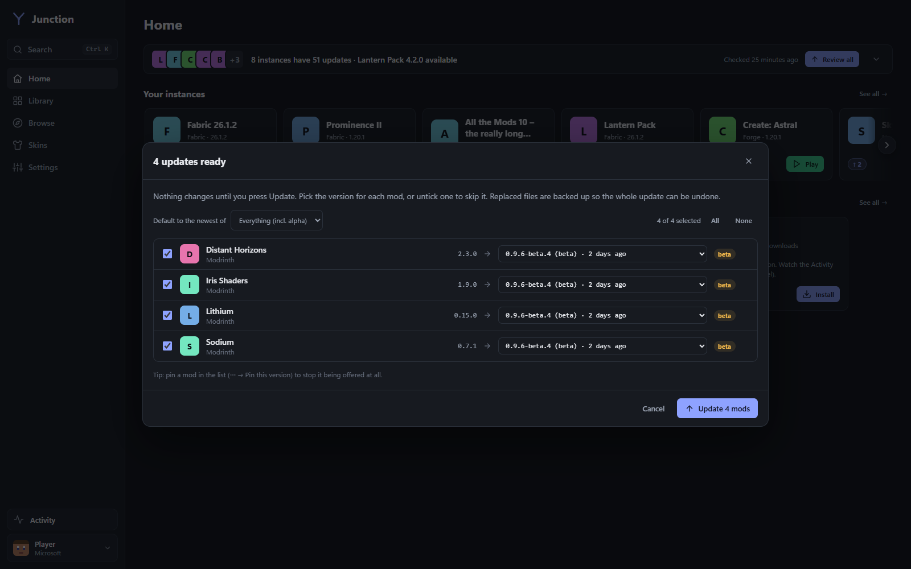
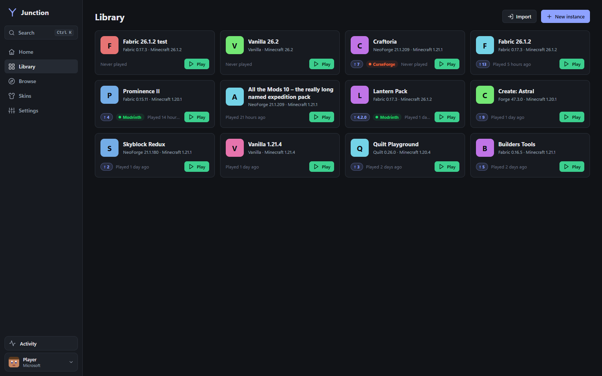
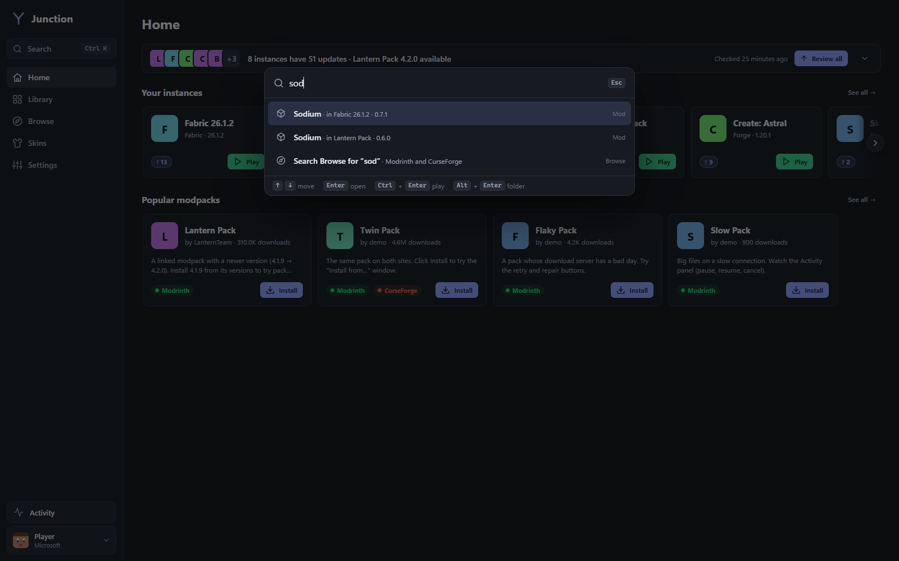
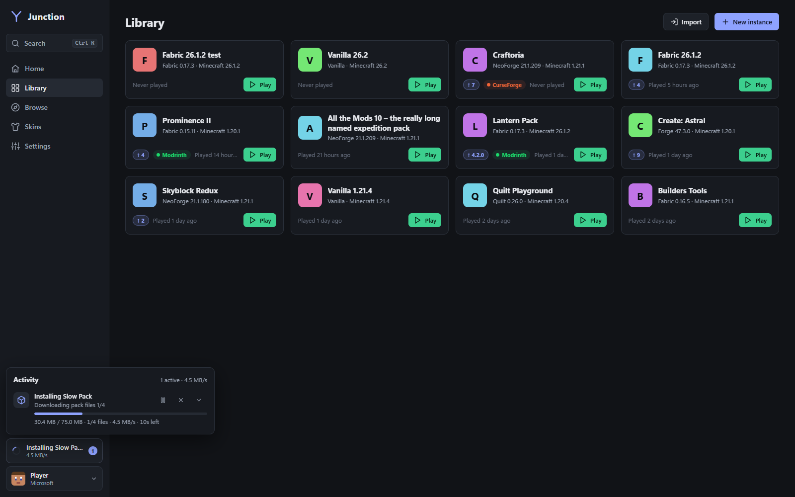
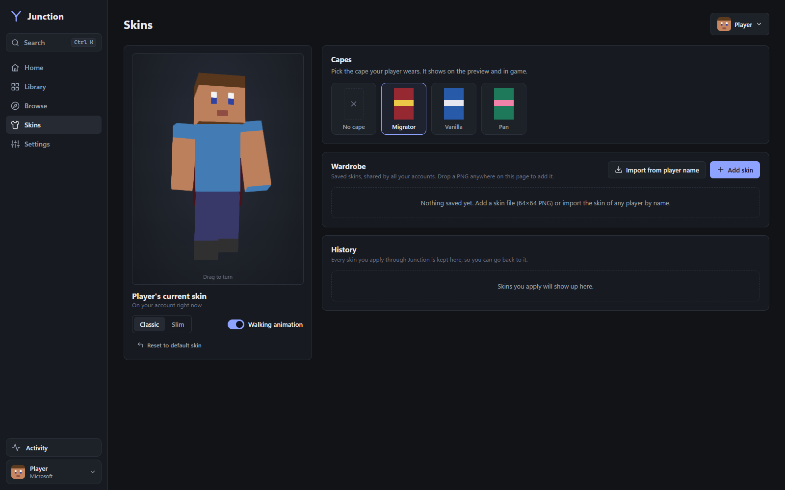
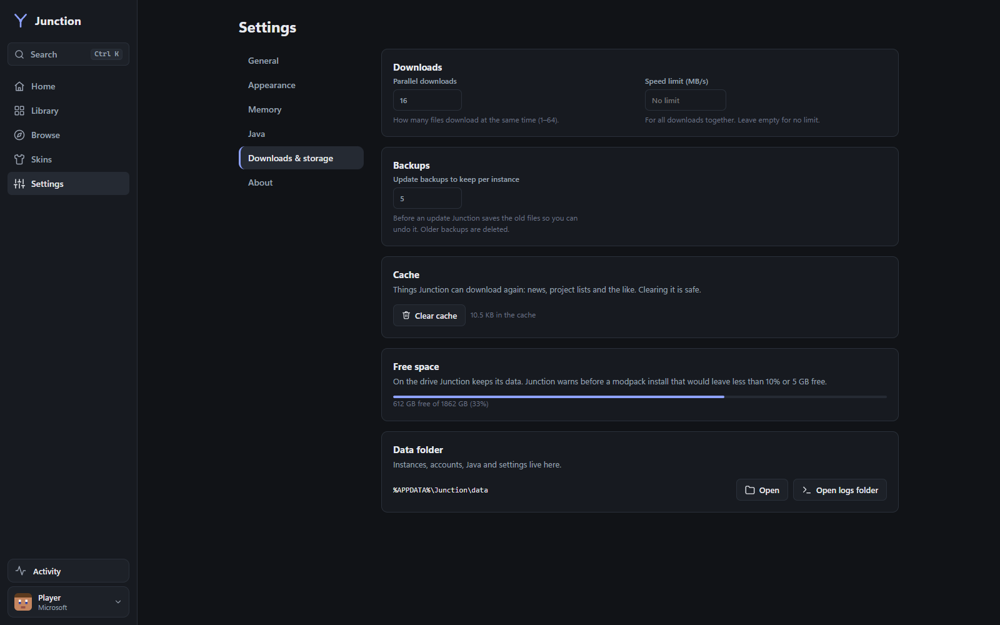

<p align="center">
  
</p>

<h1 align="center">Junction</h1>

<p align="center">
  <b>A Minecraft launcher for Modrinth and CurseForge.</b><br>
  One search for both sites. No ads, no telemetry, no lock-in.
</p>

<p align="center">
  
</p>

<p align="center"><sub>Windows · macOS · Linux. The pictures on this page use demo data.</sub></p>

---

## Features

### Search Modrinth and CurseForge at once

Results from both sites appear together. A project published on both shows up once, with a badge for each site, and when the two differ you see which version each would install and choose where to install it from. Mods, modpacks, resource packs, shaders and data packs are all covered, and required dependencies are installed for you.



### Modpacks that stay yours

A modpack stays linked to its source. Junction knows which files belong to the pack (locked, so they change only with pack updates) and which you added yourself, and shows what you changed. Update the pack, switch to another version or reinstall it, and your additions stay. A backup is made first, so any pack change can be undone.



### Updates you control

Check both sites for updates, then review them first. Pick the exact version for each mod (not just the newest), skip any of them, pin a version so it's never offered again, and undo the whole update if something breaks. "Review all" does this for every instance in one window.



### Everything you play, in one place

Your instances live in the Library, each a normal Minecraft folder. Bring over instances from the Modrinth App, the CurseForge app, Prism/PolyMC, GDLauncher, ATLauncher and the official Minecraft Launcher (the originals are only read, never changed), copy worlds and settings between instances, and export any instance as a Modrinth `.mrpack` or a CurseForge `.zip`.



### Quick search

Press <kbd>Ctrl</kbd>+<kbd>K</kbd> to jump to an instance, a mod inside any instance, a page or an action. <kbd>Enter</kbd> opens it, <kbd>Ctrl</kbd>+<kbd>Enter</kbd> plays it.



### Downloads you can see

Installs and downloads run in the Activity panel with progress, speed and time left. You can pause, resume or cancel them, and finished ones stay listed. Downloads are hash-checked, and big installs wait their turn instead of fighting each other.



### Skins

See your skin and cape in 3D, switch capes, keep a wardrobe of saved skins and a history of every skin you've applied, and import the skin of any player by name.



### Settings that explain themselves

Memory and Java per instance (with Generational ZGC and tuned G1 presets), download speed and parallelism, how many update backups to keep, and how much room is left on the drive that holds your data. Junction warns before a modpack install that would leave under 10% or 5 GB free.



### And

- **Every major loader:** Vanilla, Fabric, Quilt, Forge and NeoForge, including the new 26.x Minecraft versions.
- **Java included:** the right Java for each Minecraft version is downloaded automatically.
- **No duplicate mods:** Junction reads the mod ID inside each jar, so the same mod from both sites is caught instead of crashing the game.
- **Respects mod authors:** when a CurseForge author only allows downloads from their website, Junction opens the page, watches your Downloads folder and moves the file into place.
- **No lock-in:** your instances are plain Minecraft folders in your data folder, and every instance exports to the open `.mrpack` or CurseForge `.zip` formats.

## Privacy and security

- No ads and no analytics. Junction only talks to Mojang (game files and Java), Microsoft/Xbox (sign-in), Modrinth, CurseForge and the mod loader sites.
- Sign-in tokens and API keys are encrypted with your operating system's keychain.
- Every download is checked against its SHA-1/SHA-512 hash before it's used.
- Modpacks can't write files outside their instance folder, and mod descriptions are shown in a sandbox with scripts disabled.
- Your data lives in `%APPDATA%\Junction\data` on Windows, `~/Library/Application Support/Junction/data` on macOS and `~/.config/Junction/data` on Linux.

## Status

Junction is **pre-release**.

- **Microsoft sign-in is waiting for Mojang's API approval.** Until the app ID is approved, signing in to Minecraft fails with a 403 error. Everything else, including browsing, installing and managing instances, works without signing in.
- Not yet tried against the live services: launching the game, Forge and NeoForge installs, and CurseForge modpack installs. Expect a few rough edges there.
- Forge for Minecraft versions older than 1.13 isn't supported (its installers can't run without a window). Fabric, Quilt and vanilla work on old versions.
- Launchers installed to a non-default folder aren't found automatically. Use *Import → Browse for a folder…* for those.
- Junction doesn't update itself yet. New versions are on the [Releases page](https://github.com/danielalex011/Junction-Launcher/releases).

## Building from source

Requires [Node.js](https://nodejs.org) 22 or newer.

```bash
npm install
npm start            # run from source
npm test             # run the test suite (simulated network, never the real APIs)
npm run screenshots  # re-make the pictures in docs/screenshots/ from demo data
npm run dist:win     # Windows installer + portable zip (build on Windows)
npm run dist:mac     # macOS .dmg
npm run dist:linux   # Linux AppImage
```

### Sign-in and CurseForge keys for your build

Official builds include a Microsoft sign-in app ID and a CurseForge API key. Neither is in this repository. If you build Junction yourself, either:

- copy `build-config.example.json` to `build-config.json` and fill it in before building (the file is git-ignored), or
- set `JUNCTION_MS_CLIENT_ID` / `JUNCTION_CF_API_KEY` as environment variables, or
- leave them empty and enter them in *Settings* after starting the app.

To get them:

- **Microsoft sign-in:** register an app at [portal.azure.com](https://portal.azure.com) → *App registrations*:
  - Supported account types: *Personal Microsoft accounts only*
  - No redirect URI
  - Then under *Authentication*, set **Allow public client flows** to *Yes*.

  New apps must be approved by Mojang before they can sign in to Minecraft, using [this form](https://aka.ms/mce-reviewappid). If you fork Junction, please use your own app ID rather than the official one.
- **CurseForge:** request a key at [console.curseforge.com](https://console.curseforge.com/).

### Project layout

```
src/core/        launcher engine (plain Node, no Electron)
  minecraft/     versions, libraries, assets, Java runtimes, launch arguments
  loaders/       Fabric, Quilt, Forge, NeoForge
  sources/       Modrinth + CurseForge clients, unified search, CurseForge fingerprints
  content/       install/update/undo, duplicate detection, modpacks, export, import, world copy
  auth/          Microsoft device-code sign-in, offline accounts
src/main/        Electron main process and preload bridge
src/renderer/    user interface (HTML/CSS/JavaScript)
test/            automated tests against a simulated Mojang/Modrinth/CurseForge/Microsoft
tools/           demo data, the simulated network and the screenshot maker
```

## License

MIT. See [LICENSE](LICENSE).

The 3D skin preview uses [skinview3d](https://github.com/bs-community/skinview3d) (MIT), which includes [three.js](https://threejs.org/) (MIT) and skinview-utils (MIT). A copy ships with Junction in `src/renderer/vendor/`, with each project's license text next to it. Nothing is loaded from the web.

---

Not an official Minecraft product. Not approved by or associated with Mojang or Microsoft.
