# Junction guide

A short tour of what everything does. The pictures use demo data.

If you have never used a launcher before: **sign in, make an instance, press Play.** Everything below is detail.

**Prefer to be shown inside the app?** Junction has a one-minute guided tour: click **Take a quick tour of the app** on an empty Home page, use **Settings → About → Take the tour**, or press **Ctrl+K** and type *tour*. It lights up each part of the sidebar and says what it does. Use **Next** and **Back** or the arrow keys, and **Esc** to stop.

---

## The words you will see

| Word | What it means |
| --- | --- |
| **Instance** | Your own copy of Minecraft with its own mods, settings and worlds. Break one and the others are fine. |
| **Mod** | An add-on that changes the game. |
| **Modpack** | A ready-made bundle of mods that work together. |
| **Mod loader** | The thing mods plug into. **Vanilla** = none (plain Minecraft), **Fabric** = the most popular and a good default, **Quilt** = works with most Fabric mods, **Forge / NeoForge** = the classic loaders, used by many big modpacks. A mod only works with the loader it was made for. |
| **Modrinth / CurseForge** | The two websites mods come from. Junction searches both at once. |

---

## The sidebar

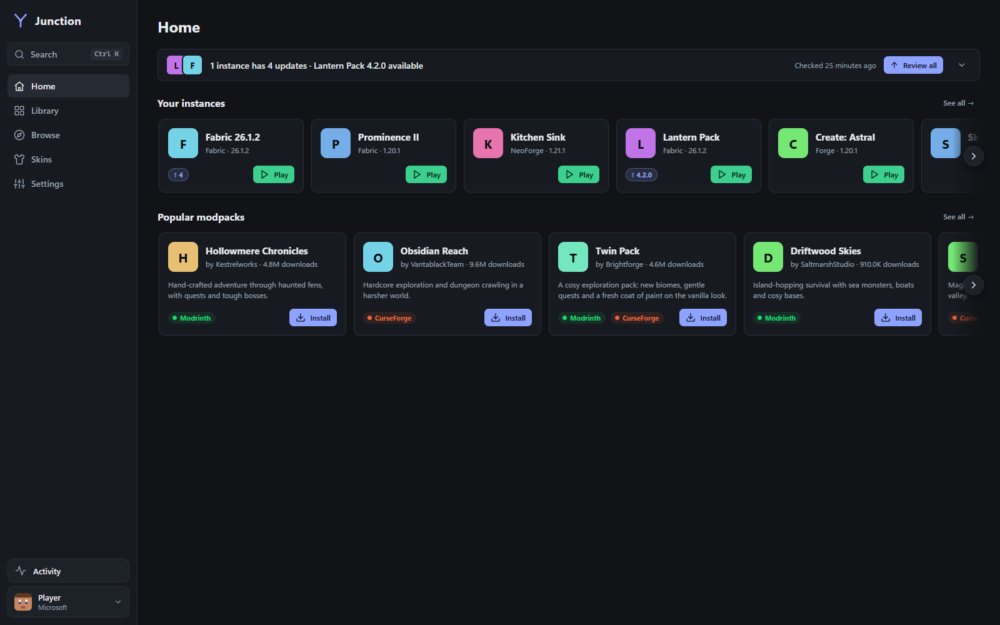

| Button | What it does |
| --- | --- |
| **Search (Ctrl+K)** | Finds your instances, mods and settings from anywhere. Type a few letters and press Enter. |
| **Home** | Your recent instances, an updates bar and popular modpacks. |
| **Library** | All your instances. **New instance** makes one; **Import** brings in instances from other launchers. |
| **Browse** | Search mods, modpacks, resource packs, shaders and data packs. |
| **Skins** | Change your skin and cape. |
| **Settings** | Memory, Java, themes, downloads and more. |
| **Activity** | Everything that is downloading or installing, with pause and cancel. |
| **Account** (bottom left) | Sign in, switch accounts or add an offline one. |
| **Paintbrush** | Jumps to Appearance. |

---

## Your account

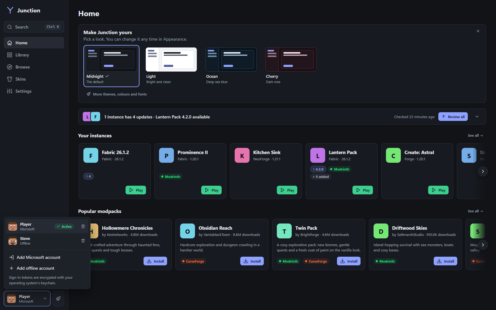

Click the account at the bottom left and choose **Add Microsoft account**. You sign in on Microsoft's own page, so your password never goes through Junction. The signed-in account has an **Active** badge; click another to switch. **Offline accounts** (play without signing in) unlock after you have signed in once with an account that owns Minecraft.

---

## Making an instance

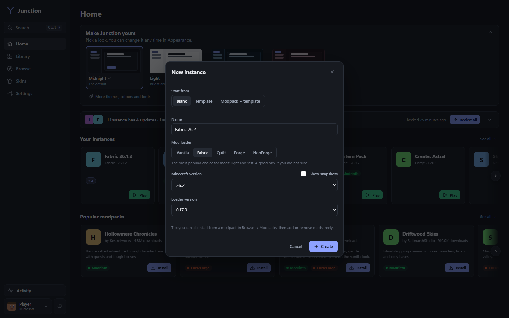

**Library → New instance.** The suggestions are fine for most people:

- **Start from:** *Blank*, a *Template* you saved before, or a *Modpack + template*.
- **Mod loader:** a one-line hint under the buttons tells you what each one is.
- **Minecraft version** and **Loader version:** the newest is picked for you.

Press **Create**, then **Play** on its card. The first launch downloads the game and the right Java by itself, so it takes a few minutes.

---

## Finding and installing mods

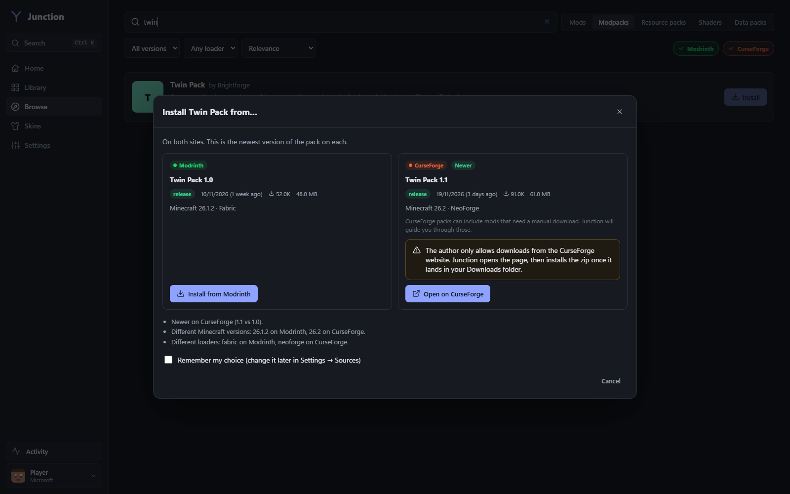

**Browse** searches Modrinth and CurseForge together. A project on both sites shows once with a badge for each. For a mod, click **Install…** and pick the instance (**Add mods** inside an instance installs straight into that one). For a modpack, **Install** makes a new instance from it. When a modpack is on both sites, **Install from…** shows what each site offers (newest version, Minecraft version, loader) so you can choose.

Some CurseForge authors only allow downloads from their own page. Junction then opens that page, watches your Downloads folder and moves the file in for you.

---

## Inside an instance

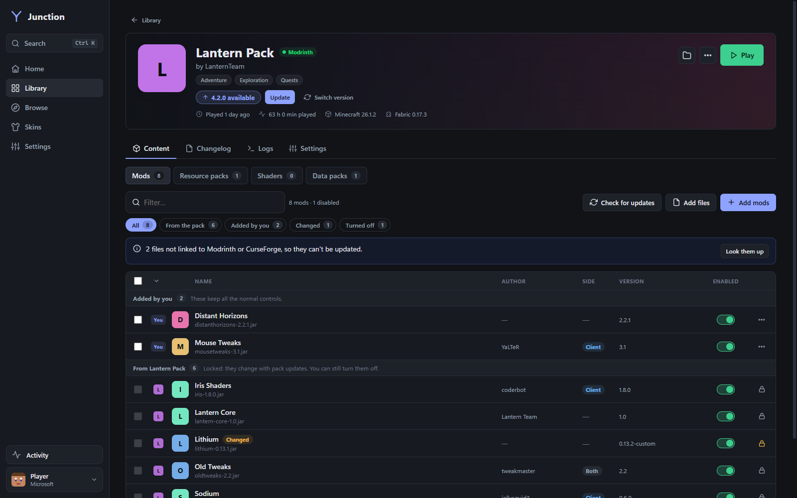

Click an instance card to open it. The **Content** tab lists everything installed:

- The filters sort **From the pack**, **Added by you**, **Changed** (you edited a pack file) and **Turned off**.
- The switch on a row turns a mod off without deleting it.
- A padlock means the file belongs to the modpack: it changes only when the pack updates.
- **Check for updates** looks at both sites. **Add mods** and **Add files** put more in.

---

## Updating safely

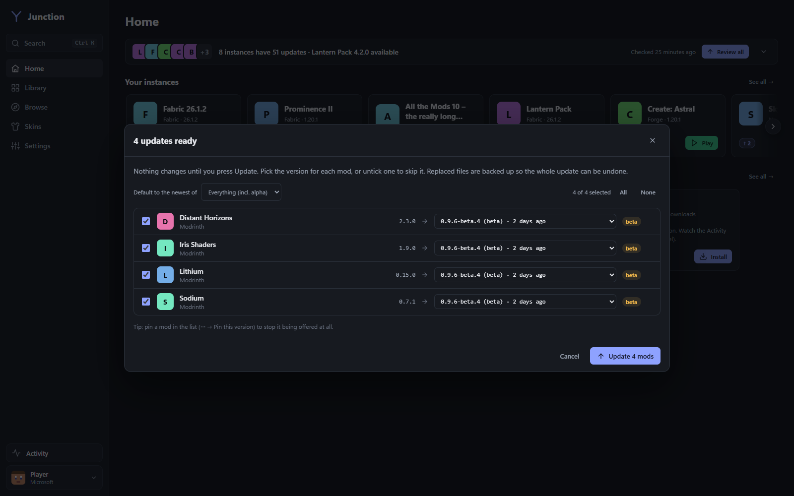

Nothing changes until you press **Update**. Pick the version for each mod, untick any you want to skip, and pin a mod to stop it being offered. Replaced files are backed up, so a whole update can be undone.

---

## Downloads you can see

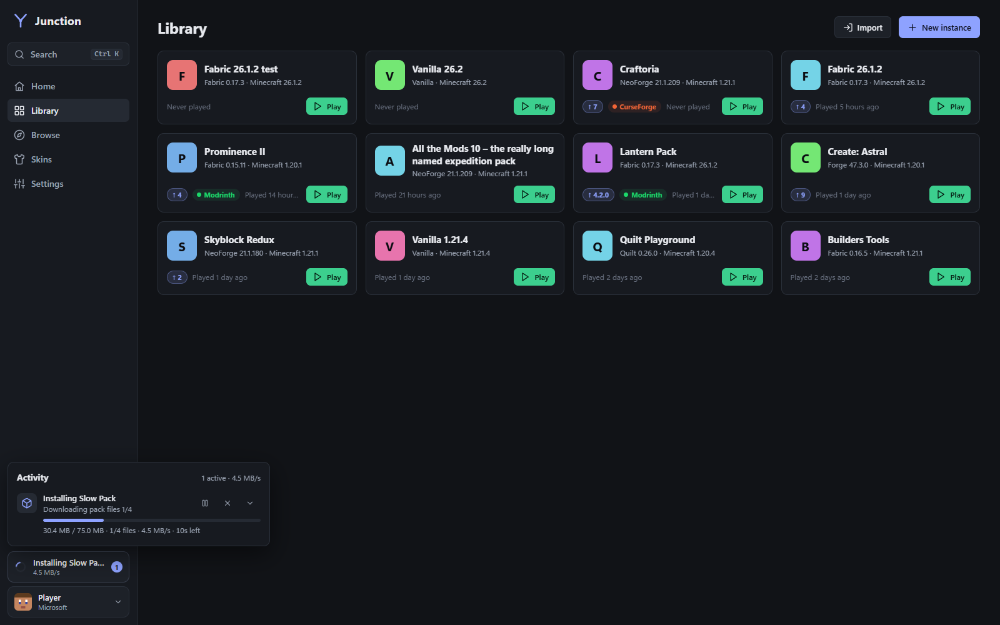

The **Activity** button shows progress, speed and time left. You can pause, resume or cancel a download, and finished ones stay listed.

---

## Skins

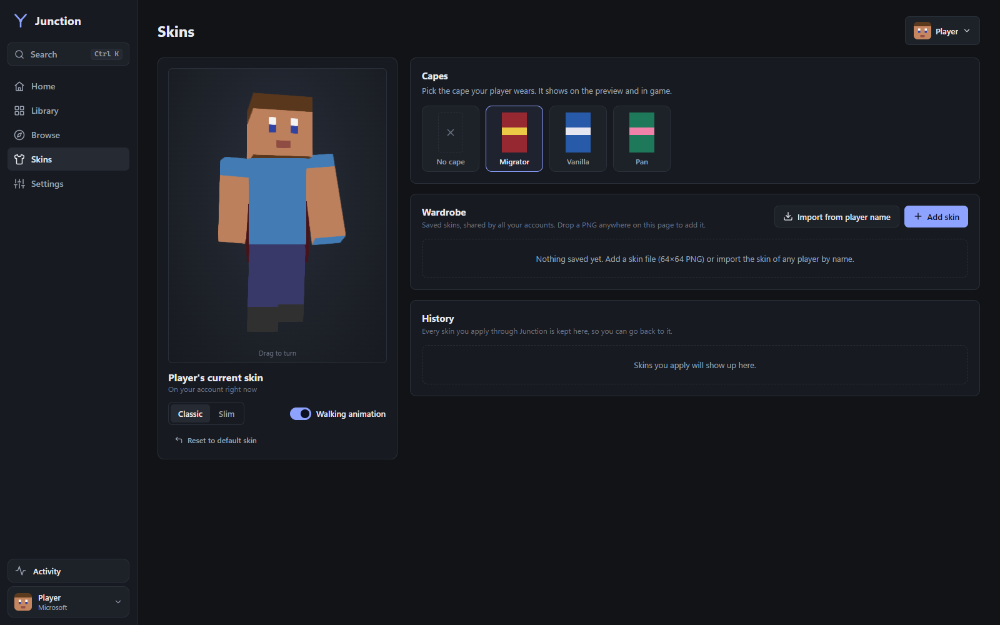

Pick a cape, add skin files to your **Wardrobe**, import a skin by player name, and switch back to any skin in **History**. **Reset to default skin** puts the standard one back. Your head in the sidebar updates on its own.

---

## Search anything: Ctrl+K

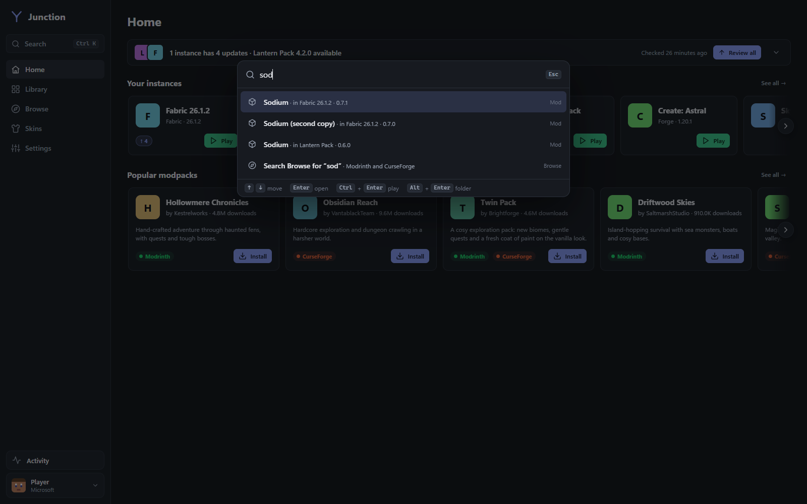

Works from every page. Try a mod name, an instance, or a setting like *theme*, *memory* or *java*.

---

## Make it yours

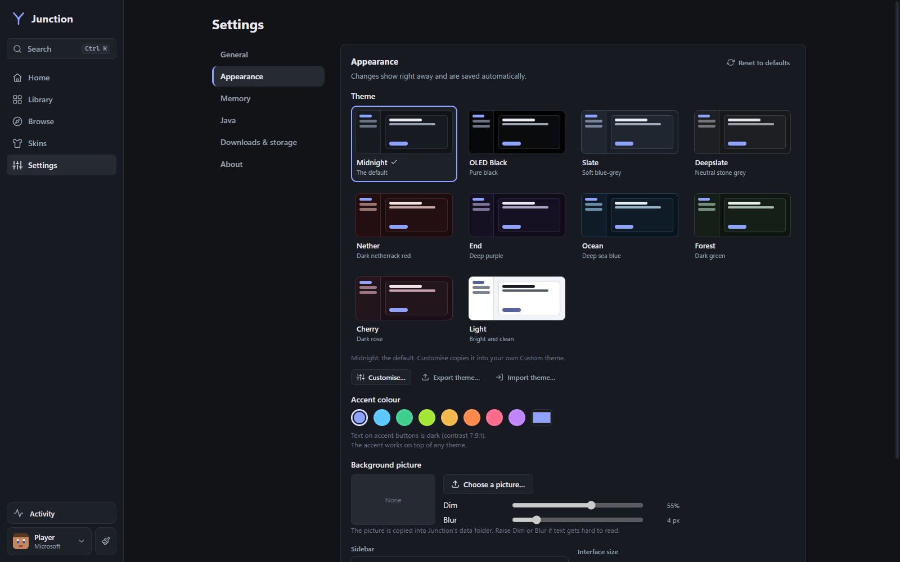

**Settings → Appearance** has ten themes (including Light and OLED Black), an accent colour that works on top of any theme, a background picture, a sidebar on either side, interface size and a choice of font. **Customise…** lets you change every colour, and **Export theme…** / **Import theme…** share a look as a small file.

---

## Settings and your files

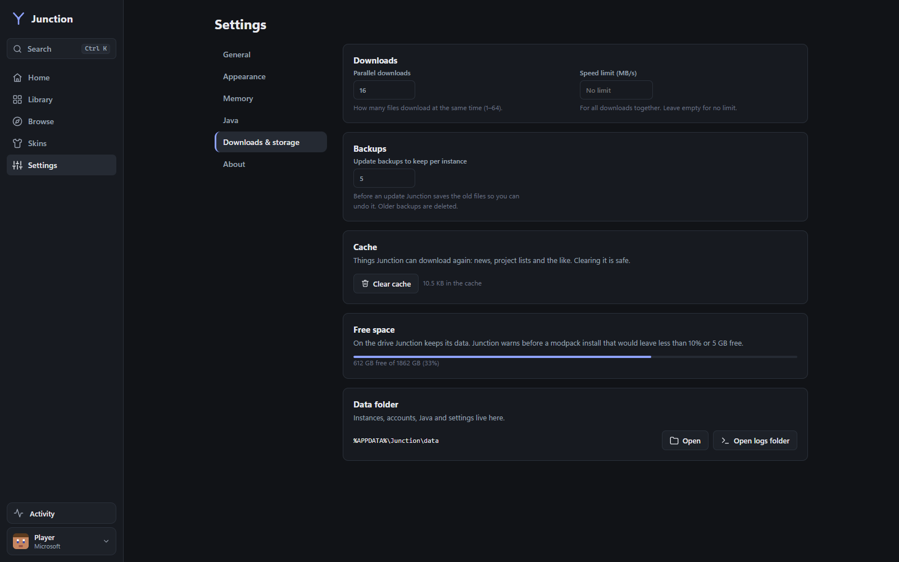

- **Memory:** how much RAM the game may use. The default is sensible; raise it for big modpacks.
- **Java:** Junction downloads the right Java for you. Change it only if you know why.
- **Downloads & storage:** parallel downloads, a speed limit, how many update backups to keep, the cache, free space, and **Open** for your data folder.

Your instances, accounts and settings live in `%APPDATA%\Junction\data`. Delete Junction and that folder is still there.

---

## When something goes wrong

- **A mod does not show up in the game:** check it matches the instance's Minecraft version and mod loader.
- **The game closes at once:** open the instance's **Logs** tab; the last lines usually say why.
- **A download failed:** the Activity panel has a **Retry** button. For a broken modpack, open its **⋯** menu and choose **Repair modpack**.
- **Windows says "Windows protected your PC":** the installer is not code-signed yet. Click **More info, then Run anyway**.
- **Ask for help:** Settings → About → **Copy debug info** gives you text without passwords or tokens to paste into an issue.
